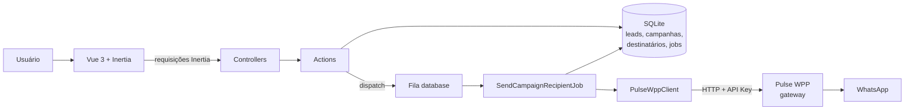
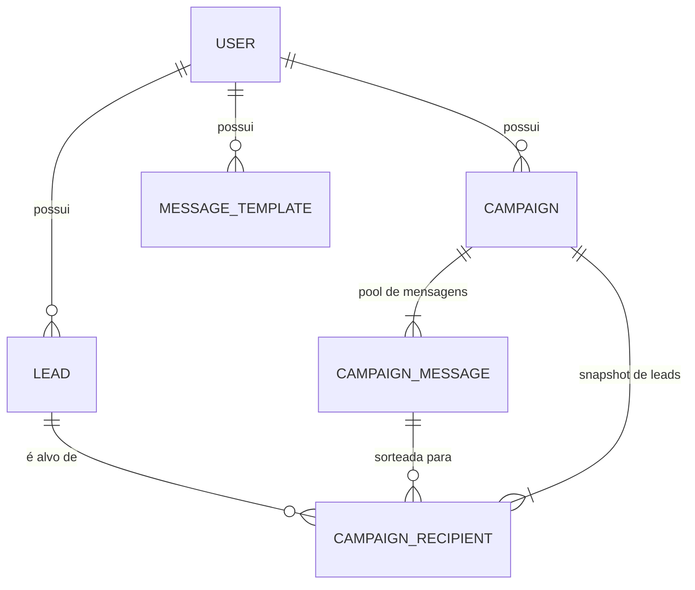
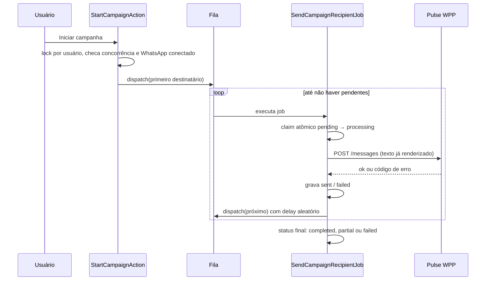

# Pulse

CRM de prospecção comercial: importa leads, organiza em um pipeline Kanban e dispara campanhas de WhatsApp em massa, de forma segura e em background.


## O problema

Quem prospecta clientes para um negócio local costuma ter a lista de empresas numa planilha (vinda de uma ferramenta de captação) e gasta o dia em trabalho manual:

- copiar telefones e abrir conversas no WhatsApp uma a uma;
- esquecer em que etapa cada empresa está e quem já foi contatado;
- reescrever a mesma mensagem, ajustando só o nome da empresa;
- disparar para muita gente de uma vez e arriscar o bloqueio do número por comportamento de spam.

O Pulse centraliza esse fluxo: **captar → importar → organizar → contatar → acompanhar → fechar**.

## Funcionalidades

- **Leads**: CRUD, busca, filtros, notas, exclusão em lote e importação de planilhas XLSX/CSV com pré-visualização e validação linha a linha.
- **Pipeline Kanban**: `new → contacted → conversation → meeting → proposal → won / lost`, com drag and drop.
- **Templates de mensagem**: textos reutilizáveis com variáveis (`{nome}`, `{cidade}`, ...) substituídas pelos dados de cada lead.
- **Campanhas de WhatsApp**: envio em massa, um destinatário por vez, com intervalo aleatório entre envios, várias mensagens candidatas sorteadas por destinatário e progresso ao vivo.
- **Conexão com WhatsApp**: pareamento por QR Code e status da sessão pela interface.
- **Autenticação**: login, registro, verificação de e-mail, 2FA (TOTP) e passkeys, via Laravel Fortify.
- **Multiusuário**: leads, templates e campanhas pertencem a um único usuário.

## Arquitetura

O Pulse é um monólito Laravel com frontend Vue servido via Inertia. O envio de WhatsApp **não** fica no Pulse: ele conversa por HTTP com o **Pulse WPP**, um gateway separado que mantém a sessão do WhatsApp. O Pulse só orquestra (fila, intervalos, estados); o gateway só envia.



### Camadas

| Camada | Responsabilidade |
|---|---|
| `app/Http/Controllers` + `Requests` | Entrada HTTP e validação. Sem regra de negócio. |
| `app/Actions` | Uma ação de negócio por classe (`CreateCampaignAction`, `StartCampaignAction`, `ImportLeadsAction`, ...). |
| `app/Data` | DTOs (`spatie/laravel-data`) usados como entrada das Actions e como resposta tipada do gateway. |
| `app/Services/PulseWppClient` | Único ponto de contato com o gateway; traduz falhas em `PulseWppException` com códigos estáveis. |
| `app/Jobs/SendCampaignRecipientJob` | Envia a um destinatário e encadeia o próximo. |
| `app/Models` + `Enums` | Estado do domínio (`LeadStatus`, `CampaignStatus`, `CampaignRecipientStatus`, ...). |
| `resources/js/pages` | Páginas Vue (uma pasta por recurso), com rotas tipadas via Wayfinder. |

O vocabulário do domínio (Lead, Campaign, Lead snapshot, CampaignRecipient, ...) está definido em [`CONTEXT.md`](CONTEXT.md).

### Modelo de dados



### Fluxo de uma campanha



## Decisões técnicas

As decisões com contexto completo estão em [`docs/adr`](docs/adr). As principais:

- **Gateway de WhatsApp separado.** O Pulse não guarda sessão nem fala o protocolo do WhatsApp; isso fica no Pulse WPP (ver [`pulse-wpp-integration.md`](pulse-wpp-integration.md)). O Pulse depende só de `error.code`, nunca do texto das mensagens de erro. Antes dele, a abordagem era só links `wa.me` no cliente ([ADR 0002](docs/adr/0002-whatsapp-templates-stay-client-side.md)); esses links continuam no envio individual a partir do lead.
- **Job encadeado, um destinatário por vez.** Há uma única conexão de WhatsApp, então cada job envia a um destinatário e despacha o próximo com `delay` aleatório (`delay_min_seconds`–`delay_max_seconds` da campanha). Isso evita `sleep` dentro de job (que o worker acabaria reclamando como travado) e simula um ritmo humano.
- **Sem duplo envio.** O job reivindica o destinatário com um `UPDATE ... WHERE status = 'pending'` condicional. Se dois jobs se sobrepuserem, só um envia. `processing` é interno e aparece como "pendente" para o usuário.
- **Snapshot de leads.** A campanha congela os leads no momento da criação; mudar o status de um lead depois não altera quem recebe a mensagem. Só entram leads com telefone que o `NormalizePhoneAction` valida.
- **Recuperação de falhas.** `$tries = 1`, `retry_after` maior que o `timeout` do job e callback `failed()` que resolve o destinatário preso e continua a cadeia. Uma campanha com envios e falhas termina como `partial` em vez de `failed` ([ADR 0006](docs/adr/0006-campaign-partial-status-and-job-failure-recovery.md)). Se a sessão do WhatsApp cai (`WHATSAPP_AUTH_REQUIRED`), a campanha inteira é abortada.
- **SQLite com retry de lock.** Fila e app compartilham o banco; escritas do resultado do envio tentam de novo em erros de `database is locked` ([ADR 0004](docs/adr/0004-retry-sqlite-lock-errors-in-send-campaign-job.md)).
- **Uma campanha por vez, por usuário.** `StartCampaignAction` usa `Cache::lock` para que duas requisições simultâneas não passem juntas pela checagem.
- **Actions com DTOs.** Entradas de Actions usam `spatie/laravel-data` em vez de arrays soltos ([ADR 0001](docs/adr/0001-use-spatie-laravel-data-for-action-inputs.md)).
- **Logs estruturados** no fluxo de campanha, com eventos nomeados (`campaign.started`, `campaign.recipient.sent`, ...) e contexto consistente ([ADR 0005](docs/adr/0005-structured-campaign-logging.md)).
- **Inertia v3 + Vue 3 + TypeScript**, sem API REST separada. Rotas e formulários chamam controllers por funções geradas pelo **Wayfinder**, então rota renomeada vira erro de tipo.
- **Qualidade automatizada.** Pint (estilo), Larastan nível 7, ESLint, Prettier e `vue-tsc` rodam junto com os testes no CI.

## Stack

Laravel 13 · PHP 8.5 · Inertia v3 · Vue 3 · TypeScript · Tailwind CSS 4 · reka-ui · SQLite · Laravel Fortify · Spatie Laravel Data · Maatwebsite Excel · Pest 5

## Como rodar

### Pré-requisitos

- PHP 8.3+ (o CI usa 8.5) com extensão SQLite
- Composer 2
- Node.js 22+
- Uma instância do **Pulse WPP** acessível, apenas para usar a conexão com o WhatsApp e as campanhas. O resto do app funciona sem ela.

### Instalação

```bash
git clone https://github.com/GabrielLacerda000/Pulse.git
cd Pulse
composer setup
```

O `composer setup` instala as dependências PHP e JS, cria o `.env` a partir do `.env.example`, gera a `APP_KEY`, roda as migrations e compila o frontend.

Se o arquivo SQLite ainda não existir, crie-o antes das migrations:

```bash
touch database/database.sqlite
```

### Configuração do gateway

No `.env`:

```dotenv
PULSE_WPP_BASE_URL=http://localhost:3000
PULSE_WPP_API_KEY=sua-chave
```

A chave deve ser a mesma configurada no Pulse WPP.

### Desenvolvimento

```bash
composer dev
```

Sobe em paralelo o servidor (`http://localhost:8000`), o worker da fila (necessário para as campanhas) e o Vite.

Depois, crie uma conta em `/register`, importe leads em **Leads → Importar** e conecte o WhatsApp em **WhatsApp**.

## Testes

Os testes usam Pest, com banco em memória e o gateway simulado via `Http::fake`, então nenhum teste exige o Pulse WPP no ar.

```bash
php artisan test --compact                        # tudo
php artisan test --compact --filter=Campaign      # por nome
php artisan test --compact tests/Feature/Jobs     # por pasta
```

O que está coberto:

| Área | Onde |
|---|---|
| Leads, importação, pipeline, templates, campanhas | `tests/Feature/*Test.php` |
| Envio de campanha (claim, falhas, aborto por auth, status parcial) | `tests/Feature/Jobs/SendCampaignRecipientJobTest.php`, `tests/Feature/Actions/StartCampaignActionTest.php` |
| Cliente do gateway e mapeamento de erros | `tests/Feature/Services/PulseWppClientTest.php` |
| Autenticação, 2FA e configurações | `tests/Feature/Auth`, `tests/Feature/Settings` |
| Normalização/máscara de telefone e renderização de variáveis | `tests/Unit/Actions` |

### Checagens de qualidade

```bash
composer lint:check     # Pint
composer types:check    # Larastan (PHPStan nível 7)
npm run lint:check      # ESLint
npm run format:check    # Prettier
npm run types:check     # vue-tsc
composer ci:check       # tudo acima + testes, igual ao CI
```

O workflow em [`.github/workflows/tests.yml`](.github/workflows/tests.yml) roda o `ci:check` a cada push na `main` e em todo pull request.

## Documentação adicional

- [`CONTEXT.md`](CONTEXT.md): glossário do domínio
- [`PRD.md`](PRD.md): escopo e requisitos
- [`docs/adr`](docs/adr): decisões de arquitetura
- [`docs/db.md`](docs/db.md): tabelas
- [`pulse-wpp-integration.md`](pulse-wpp-integration.md): contrato da API do gateway
